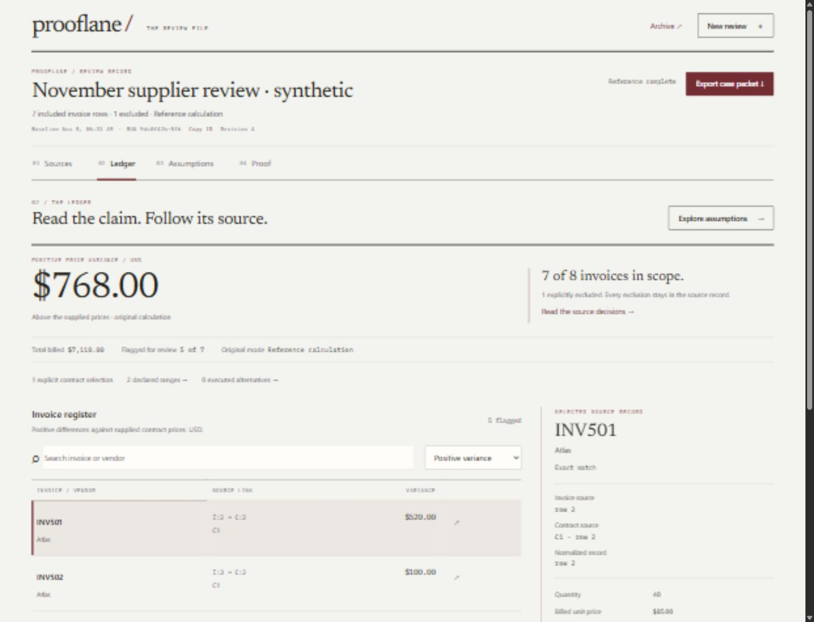

# Prooflane — Audit Folio

5 ноября 2026, Asia/Qyzylorda. Реализованный локальный интерфейс: [открыть приложение](http://127.0.0.1:8765). Код после исправлений: `627eb82`; первый законченный Folio: `7600108`. До изменения сохранена точка возврата `checkpoint/before-studio-20261105` на `0782a52`.

## Что изменилось

Prooflane организован как аннотированное дело: **Sources → Ledger → Assumptions → Proof**. Одна последовательность глав, регистры с линейками, отдельное поле примечания и типографический итог с явным охватом. Archive открывается по требованию. Постоянная боковая панель, повторная навигация и ряд равнозначных карточек убраны.

Арт-дирекция — бумага, чернила, бордовая аннотация. Newsreader используется для заголовков и результата, IBM Plex Mono — для ссылок на записи и числовых деталей, системный sans — для действий и длинного текста. Цвет выделяет выбранный объект; состояния также названы словами. Нет декоративных градиентов, текстур бумаги, печатей подлинности или выдуманных графиков.

Это необработанный браузерный JPEG, не макет. Синтетические данные; Reference calculation. Некоторая мягкость мелкого текста присутствует в полученных browser captures и не исправлялась обработкой изображения.

## Аудит процесса и инструкций

Прочитаны текущий проект, AGENTS.md, прежняя визуальная спецификация, связанные workflows и реальные обработчики приложения. В затрагиваемых подкаталогах дополнительных AGENTS.md не обнаружено. [Независимый UX/process audit](docs/design-studio/UX_AND_PROCESS_AUDIT.md) фиксирует предметный сценарий и DOM/state-контракт.

Наблюдаемая причина повторения: прежняя `WORKSPACE_DESIGN.md` прямо задавала rail204–220px, дублирующую навигацию, четыре метрики и общий workbench. После смены палитры контейнер оставался основной единицей композиции. Корректные расчёты, отсутствие overflow и работающие кнопки проверяли функциональность, но не доказывали индивидуальную арт-дирекцию. Это вывод из исходников и кадров Prooflane, а не заявление о скрытых рассуждениях прежнего автора.

Новый пользовательский запрос заменяет прежнее визуальное предписание. Старый документ помечен историческим; его ограничения для данных, baseline, API и происхождения результата сохраняются. AGENTS.md сохранён байт-в-байт. Другие проекты пользователя **не сравнивались**: в рабочей области исследован только Prooflane, соседние проекты не открывались и не изменялись. Межпроектное визуальное разнообразие этим результатом не доказано.

| Возможность / роль | Конкретный вклад |
|---|---|
| project-bootstrap | Обнаружение доступных возможностей, план новой задачи, сохранение guidance; итоговый verify только структурный |
| hub-innovation | Разделение разных композиций и предметных возможностей; без расширения продукта несвязанными функциями |
| hub-engineering | Реализация в существующем vanillaJS/FastAPI, сохранение API/ID и проверка интеграции |
| hub-audit | Отдельные наблюдения независимого критика, воспроизведённые дефекты и повторная оценка |
| Creative / Visual director — отдельный агент | Семь первичных референсов и три сопоставимых векторных листа; исходники приложения не менял |
| Product UX / Interaction — отдельный explorer | Инварианты сценария, независимая оценка концепций, риски доступности и continuity |
| Frontend engineer — отдельный worker | Новая композиция и реальные взаимодействия; владел HTML/CSS/JS и сфокусированными JS-проверками |
| Independent Design Critic / QA — отдельный агент | Сам работал в браузере в цикле1; в цикле2 отдельно изучил кадры/код и запустил CLI |
| Root | Интеграция, лицензированные локальные шрифты, исправления, собственный повторный браузерный проход и финальные артефакты |

Названия design-ролей здесь обозначают обязанности существующих доступных агентов. Несуществующие специализированные агенты не объявлялись вызванными. 3D, генерация изображений, React skills и hosted-site builders не применялись: они не требуются этой реализации.

## Исследование и три разные концепции

Просмотрены семь актуальных первичных источников: [Mercury Books](https://mercury.com/books), [Ramp AP](https://ramp.com/accounts-payable), [Linear design process](https://linear.app/method/manage-design-projects), [Stripe Financial Connections](https://stripe.com/financial-connections), [Instrument / ServiceNow](https://www.instrument.com/work/servicenow-rebrand), [Pentagram / SMCC](https://www.pentagram.com/work/smcc), [Observable Plot marks](https://observablehq.github.io/plot/features/marks). Root дополнительно визуально открыл Mercury и Instrument. Приватные приложения не выдаются за полностью протестированные.

Из источников взяты принципы: предметный процесс, ясные состояния, разные задачи display/text-типографики, согласованность identity и точное представление данных. Чужие UI-компоненты, композиции и изображения не переносились. [Подробные наблюдения, применимость и границы каждого источника](docs/design-studio/REFERENCES_AND_CONCEPTS.md).

| Концепция | Композиция, навигация и взаимодействие | Основной риск |
|---|---|---|
| [A — Evidence Atlas](artifacts/design-studio/concepts/A-evidence-atlas.svg) | Пространственный граф происхождения; фокус на узле и его родителях; scientific sans, лесной фон; направленный trace motion | Навигация графа,500записей, keyboard/mobile эквивалент требуют крупной новой поверхности |
| [B — Audit Folio](artifacts/design-studio/concepts/B-audit-folio.svg) | Последовательность глав, регистр и примечание; editorial serif/mono; выбор цитаты переносит её в Proof; короткое движение аннотации | Излишняя декоративная «бумага» или большой заголовок могли вытеснить работу |
| [C — Comparison Theatre](artifacts/design-studio/concepts/C-comparison-theatre.svg) | Сцена baseline и параллельных альтернатив; выбор сравниваемых tracks; тёмная техническая типографика, синхронные изменения | Спорные исходники и исключения оказываются второстепенными |

Листы одинакового размера1500×820 показывают вход и загруженное дело. Это **статические синтетические эскизы**, не работающие прототипы. [Галерея](artifacts/design-studio/concepts/index.html), [общий фактический кадр галереи](artifacts/design-studio/three-concepts-full.png).

Независимая предварительная оценка UX-агента,1–10:

| Критерий | Atlas | Folio | Theatre |
|---|---:|---:|---:|
| Originality | 9 | 8 | 7 |
| Visual quality / потенциал эскиза | 7 | 8 | 8 |
| Product fit | 7 | 9 | 6 |
| Usability | 5 | 8 | 7 |
| Interaction quality | 8 | 8 | 8 |
| Technical feasibility | 5 | 9 | 7 |

Выбран **Folio**: он покрывает весь путь от спорного источника до передачи доказательств. Atlas сильнее как локальная схема, Theatre — как сравнение уже согласованных вариантов. Выбор не сводился к палитре или простоте реализации. Условия независимого выбора — убрать rail/cards, связать главы одной выбранной записью, показывать исключения, сохранить исходный baseline и сделать отдельный мобильный порядок — проверялись на готовом приложении. Оценки концепций субъективны и не заменяют тесты результата.

## Interaction thesis: выбранный источник ведёт чтение

- Выбор invoice меняет примечание с оригинальной invoice record, contract record и нормализованной record. **Follow this source in Proof** продолжает именно эту запись. Исключённая запись показывает причину и отсутствие расчёта.
- Результат и охват имеют разные уровни иерархии: `$768` рядом с `7of8`, а не четыре одинаковые KPI-карточки. Исключение не превращается в нулевой или «проверенный» счёт.
- В Assumptions исходные `$768` остаются закреплённой точкой. Declared ranges и executed alternatives находятся в двух настоящих вкладках с Arrow Left/Right, Home/End, фокусом и одним активным panel.
- Sensitivity выбирает конкретный редактируемый target. Концы диапазона подписаны точными суммами; low/high имеют разные markers. График не зависит от hover и не изображает вероятность.
- Source inputs после сопоставления сворачиваются нативным disclosure, освобождая место очереди решений. Их можно открыть и изменить; изменение инвалидирует прежнее сопоставление.
- Archive — нативный dialog со списком текущей сессии, Escape и возвратом фокуса. Single CSV review сохранён внутри Archive, возврат сохраняет case.
- Motion ограничен выбором аннотации, чтением и настоящей pending-операцией. Числа не прокручиваются через выдуманные промежуточные суммы. `prefers-reduced-motion` предусмотрен в коде; его фактическая системная активация не проверялась.

## Реальные проверки и итерации

Приложение запущено Uvicorn на localhost8765. Все браузерные действия — через CUA. Использованы только вымышленные данные, без расходов и вызовов модели.

| Проверка | Фактический результат / источник |
|---|---|
| Python regression | **155 PASS**,1Starlette deprecation warning; [лог](artifacts/design-studio/python-regression.txt). Backend после этого не менялся |
| Финальные JS-проверки | **16 PASS**; [лог](artifacts/design-studio/js-final.txt). Включают source8→normalized7 после исключения, missing-binding refusal и состояния вкладок/modal |
| Existing async/failure probes | **12 групп PASS** на финальном JS; [артефакт](artifacts/design-studio/async-regression.json). Настоящие функции в NodeVM, DOM/fetch boundaries stubbed; не браузер |
| project-bootstrap verify | **PASS / STRUCTURAL_ONLY**; [результат](artifacts/design-studio/bootstrap-verify.json). Не запускает приложение |
| DOM/source continuity | Сохранены все237прежних ID,249текущих уникальны; [финальный статический аудит](artifacts/design-studio/final-static.json) |
| Независимый browser cycle1 | SourceC2R+исключение → baseline768/7110/7of8 → диапазоны148..1993 → настоящие варианты368/568 → browser download → browser upload verifier+CLI6checksPASS; [report](artifacts/design-studio/critic-cycle1.md) |
| Root browser cycle2 | Повтор source8/INV507→normalized7 и excludedINV506→explicitreason; диапазоны148..1993; invalid→valid; Archive Escape; legacy1480→1160/−320 и возврат; [report](artifacts/design-studio/critic-cycle2.md) |
| Последний browser packet | Реально скачан из root-сессии; [пакет](artifacts/design-studio/browser-case-cycle2.json), [CLI6группPASS](artifacts/design-studio/browser-case-verification.json); критик отдельно повторилCLI. В этом пакете **0alternatives**, два выполненных варианта относятся к cycle1 |
| Последние UI recovery checks | Неверный CSVheader отклонён с точной схемой; fictional sample восстановил8rows/2unresolved. Input disclosure открылся для редактирования и свернулся после match. ArrowRight/Home/End/ArrowLeft реально меняют tab,focus,panel; Archive объявляет7includedinvoices |
| Настоящий выбор CSVфайлов | Два filechooser загрузили `examples/case-invoices.csv`682bytes и `case-contracts.csv`281bytes; Reconcile sources показал8rows/6exact/2unresolved, INV504/INV506. После проверки загружено прежнее сохранённое дело; ошибок/warnings в журнале IAB не получено |
| Desktop / tablet / mobile | Чистые реальные captures1440×1100,900×1000,390×844,320×844. Scroll widths1425/885/375/305 равны ширине документа без scrollbar; на проверенных состояниях page overflow отсутствовал |

В первом browser backend часть мобильных кадров получилась tiled. Они сохранены как ограничение проверки и **не** приняты за успешное visual QA. После недоступности Chrome root продолжил в доступном in-app browser, получил чистые raw JPEG. Независимый критик второго цикла изучил изображения, код и CLI; он не выдаёт действия root за собственную работу во втором браузере.

Конкретные кандидаты на улучшение после просмотра результата:

| Наблюдение / кандидат | Решение и повторная проверка |
|---|---|
| Sources выбиралINV507, Proof показывал предыдущийINV501 | Исправлено через реальный bindingoriginal8→normalized7; нет угадывания номера. Настоящий cycle2переход подтверждён |
| ИсключённыйINV506 сохранял чужой расчёт в Proof | Добавлено явное состояние source7/причина/no calculation; raw desktopкадр подтверждает отсутствие подставленной суммы |
| Primary export anchor наследовал тёмный текст на бордовом | Исправлена CSSspecificity; фактические RGB255/253/249на127/38/49 и новый кадр проверены |
| Inspect называлnormalized7«source7» вместоoriginal8 | Accessible name теперь содержит оба номера с их ролями; проверены DOMимя, note и helpertests |
| Неверный диапазон не имелaria-invalid | Оба поля получаютtrue при ошибке,false при успешной отправке; сохранённый диапазон остаётся148..1993 |
| Постоянно открытые исходные textarea вытесняли очередь решений | Inputs сворачиваются после match, остаются доступны для редактирования; реально проверены раскрытие, invalidation и восстановление |
| Малые narrow-screen подписи | Существенные chapter/tool labels12px с переносом; реальные320/390кадры проверены |
| Search поле схлопывалось до20px; ошибка перекодировки labels | Исправлены flex-правила и UTF-8чтение/запись; повторная загрузка показывала нормальные controls и текст |
| Stale live announcement после открытия Archivecase | Исправлено объявление загруженного дела; actualDOMтеперь сообщает7included/Referencecomplete |
| Вернуть cards или собрать все analyticaltools в одну длинную страницу | Отклонено: текущая иерархия результата/охвата и разделение range/execution решают реальные разные задачи; наблюдаемого сбоя для возврата нет |
| Отдельная декоративная иллюстрация для768..768 | Не добавлена: count0 и next-action уже объясняют fixedinputs; новый visualstate не подтверждён необходимостью |
| Подсказка горизонтальной прокрутки таблицы/возврата к записи на mobile | Оставлена кандидатом для usabilitycheck: содержимое прокручивается внутри таблицы, общего overflow нет, но физический touch и обнаружимость прокрутки пользователями не проверены |

Исправления не затрагивают Decimal-формулу, API, SQLite, Docker isolation, session ownership, live gates или арифметику диапазонов. Из пакета не исполняется код.

## Производительность и происхождение ассетов

Три локальных GETдо:7.991/2.401/2.848ms; после первого Foliofreeze:6.644/2.583/1.909ms. [До](artifacts/design-studio/performance-before.json), [после](artifacts/design-studio/performance-after.json). Это малые последовательные локальные измерения HTTP, не LCP, browser paint, productionload или доказательство ускорения. После boundedfixes отдельно измерены финальные объёмы файлов.

Все поставляемые webfiles, включая лицензии: **486,759bytes**, из них два fonts **238,284bytes**, ниже заданного в этой задаче технического потолка768KiB. Это заметная цена индивидуальной типографики; внешние runtimeassets не добавлены. No new JSdependencies. Шрифты отдаются с того же origin, `font-display:swap`; версия400без глобальной установки. [Хеши](artifacts/design-studio/font-manifest.json), [официальные источники и OFL](THIRD_PARTY_LICENSES.md). Локальный бюджет — наше ограничение реализации, не требование организатора.

## Итоговая независимая оценка

Полные наблюдаемые аргументы и границы: [independent cycle2](artifacts/design-studio/critic-cycle2.md). Оценки субъективны; пользовательское исследование не проводилось.

| Измерение | /10 | Основание |
|---|---:|---|
| Visual originality | 8 | Document spine/register/margin заменяют rail/cardframe; table/detail сам по себе не объявляется изобретением |
| Art direction | 8 | Одна система ink/paper/annotation во всех главax, без fauxstamps/textures/gradients |
| Typography and composition | 8 | Display,reference и controls имеют разные роли; реальные320/390переносы; extreme-length cases не покрыты |
| UX clarity | 8 | Источник/нормализованная запись различены, исключения объяснены, original закреплён |
| Meaningful interactivity | 8 | Реально выполнены matching, shared/jointchanges, range tools, sourcecontinuity и packetchecks |
| Motion quality | 6 | Motion имеет предметную цель; timing/плавность/OSreducedmotion не измерены |
| Responsiveness | 8 | Четыре реальных ширины и чистые мобильные кадры; не все устройства/zoom/500rows |
| Accessibility | 7 | Нативные controls/dialog, Escape/focusreturn, actualkeyboardtabs, localerrors; полного screenreader/контраста всехсостояний нет |
| Product identity | 8 | Reviewsource, scope, original и portableevidence определяют композицию и действия |
| Overall execution | 8 | Рабочая новая структура и два цикла boundedreview; доступность и motion пока подтверждены частично |

## Скриншоты и оставшиеся границы

- [Desktop — Ledger](artifacts/design-studio/final-ledger1440.jpg), [новое дело](artifacts/design-studio/final-entry1440.jpg), [очередь источников](artifacts/design-studio/final-sources1440.jpg).
- [Tablet900](artifacts/design-studio/cycle2-tablet900.jpg), [mobile390 — sensitivity](artifacts/design-studio/cycle2-mobile390.jpg), [mobile320 — ledger](artifacts/design-studio/cycle2-mobile320.jpg).
- [Исключённая запись](artifacts/design-studio/cycle2-exclusion-desktop.jpg), [legacycomparison](artifacts/design-studio/cycle2-legacy.jpg), [ошибкаCSV](artifacts/design-studio/final-csv-error.jpg).
- [Файлы CSV загружены через filechooser](artifacts/design-studio/final-file-upload.jpg); [структурированный журнал root-проверок](artifacts/design-studio/browser-cycle2.json).

**NOT_RUN:** полный screenreader, физический touch, runtimeOSreducedmotion и timedmotionrecording, fullWCAGaudit, исследования с бухгалтером, productionload, liveVSI и VultrVM/publicURL. Legacycomparison1480→1160 проверен в браузере; его отдельный comparisonpacket во втором цикле не скачивался/не проверялся. Casepacketdownload — другой выполненный путь.

Docker в этой сессии недоступен; новый sandboxsmoke не запускался. Прежние реальные Dockerдоказательства сохранены с их датами, ими не подменяется новый запуск. Reference обозначен как trustedfixedrules без AI/sandbox. Ни платежей, ни новых ресурсов, ни публикации не выполнялось. Exactdeadline остаётся UNKNOWN. Работающий localhost и этот дизайн не означают submission-ready или конкурсную победу.

Финальные хеши кода и артефактов: [manifest](artifacts/design-studio/final-manifest.json). Хеши фиксируют целостность сохранённого материала; не доказывают истинность данных или исполнение.
