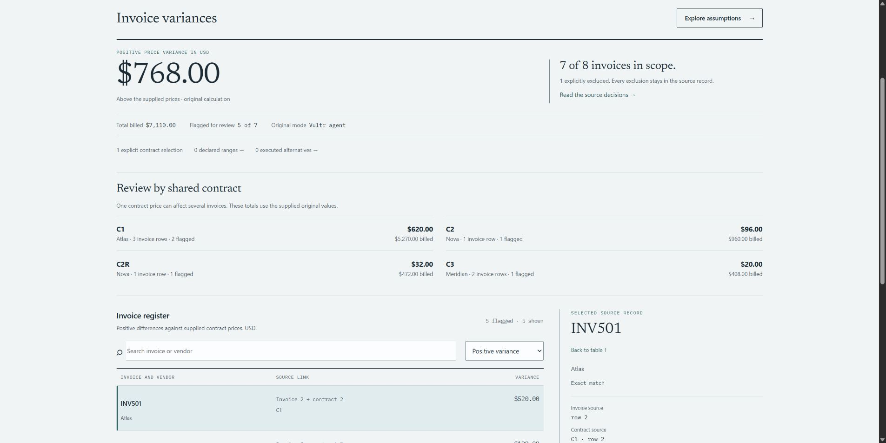
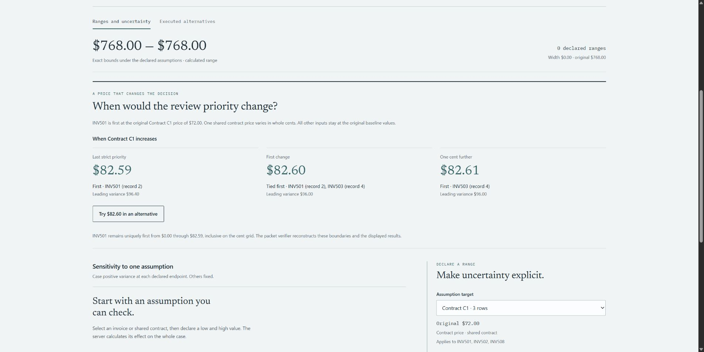
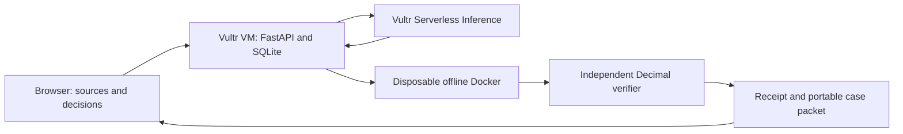

# Prooflane

**Trace the price. Challenge the assumptions. Keep the evidence.**

A review workspace for accounts payable and procurement teams investigating differences between invoice and contract prices. Resolve source decisions, execute contained analysis, test what could change your priority, and give the next reviewer a case they can reproduce.

[Live application](https://45.76.92.198/) · [Watch the live demo](submission/agent-rush/video-v2/prooflane-live-demo.mp4) · [Product walkthrough](docs/TRY_PROJECT.md) · [Architecture](docs/ARCHITECTURE.md) · [Demo and submission files](submission/agent-rush/README.md)



*Captured from the deployed application. The execution mode, scope and independent verification are visible. Open the image for full resolution; these are fictional invoices, not customer data.*

## Try the workflow

1. Open the [public demo](https://45.76.92.198/). **Open a reviewed example** loads a disclosed Reference example without a model call.
2. For a new analysis, choose **Try the fictional review**, or supply the [invoice CSV](examples/case-invoices.csv) and [contract CSV](examples/case-contracts.csv). Reconcile the sources.
3. Inspect INV504. Two dated contracts overlap; explicitly select C2R. Record why INV506 has no active supplied contract and is excluded.
4. Create a baseline. The fixture includes seven of eight invoices: **USD 768.00 positive price variance**, five flagged rows, USD 7,110 billed in scope. The USD 250 excluded billed amount is coverage information, not estimated savings.
5. Inspect a source row, review all invoices sharing C1, explore assumptions, and export the case packet. In **Proof**, run the fixed containment probes or verify a downloaded packet.

The public application supports Reference and fixed-recipe Docker workflows without an inference key. **Vultr agent** calls require an operator token to protect the available credit allowance. Never publish that token or enter the inference API key in the browser.

## What makes the review reproducible

- **Two original sources.** Match exact vendor and item keys against inclusive contract dates. Overlapping contracts need a human choice; exclusions need a reason. The frozen baseline preserves both.
- **Shared assumptions.** A change to one contract price propagates to every bound invoice. Up to four named alternatives jointly apply up to twelve distinct changes to the same original baseline.
- **Exact decision boundaries.** For the supplied fixture, C1 at USD 82.59 leaves INV501 uniquely first; USD 82.60 ties INV501 and INV503; USD 82.61 makes INV503 first. All other baseline fields stay fixed. These are deterministic what-if results, not forecasts.
- **Explicit uncertainty.** Declared ranges yield exact bounds and sensitivity. Confirming a source can reduce uncertainty; this does not estimate a probability, legal liability or recovered money.
- **Portable evidence.** Export a review CSV, a readable brief, or a JSON packet. The independent packet verifier reconstructs joins, source choices, arithmetic, declared changes and priority boundaries without executing the packet's Python.

For example, C1 at USD 80 changes three invoices and gives USD 368 positive variance. Changing C1 to USD 80 and INV501 quantity to 80 together gives USD 568. A C1 range of USD 65–85 gives USD 148–1,193 when other inputs stay fixed. [Methods and scope](docs/INTELLIGENCE_METHODS.md).



*One shared contract price changes which invoice is first to review. These are deterministic witnesses, not a forecast.*

## How Vultr powers the product

A dedicated **Vultr Cloud Compute VM in Frankfurt** runs FastAPI, SQLite and Docker. Caddy terminates public HTTPS; Uvicorn listens on loopback. This VM is the control layer, not just static hosting.

In **Vultr Serverless Inference** mode, the server requests Python for a bounded analysis task. Docker executes it in a disposable container. An independent Decimal checker verifies every reported row and total. After verification, the model selects the focus of review guidance; the server supplies the verified amounts. The interface exposes the actual model, request IDs, executed code, limits and cleanup outcome.



Real public-browser AI runs, actual Docker execution and packet verification have been observed. See the [live evidence](docs/LIVE_AI_CHECK_20261109.md), [test record](TESTING.md) and [submission checklist](docs/FINAL_SUBMISSION_20261109.md). A saved successful run does not guarantee every future model response will succeed.

## Execution modes

| Mode | Execution | Model calls | Purpose |
| --- | --- | --- | --- |
| `reference` | Trusted fixed rules in the application | None | Free introduction and arithmetic reference; not proof of agent execution |
| `sandbox` | Fixed recipe in real disposable Docker | None | Exercise execution and containment without an inference key |
| `vultr` | VSI-generated Python in real disposable Docker | Generation, at most one bounded repair, then a separate guidance request | The actual agent workflow |

The last two modes refuse to execute if Docker is unavailable. Generated code never falls back to host execution. A failed cleanup or an orphaned labelled container triggers persistent quarantine until an operator inspects the cause.

Container controls include network `none`, a read-only root filesystem, UID/GID 65534, no host mounts or injected credentials, 128 MiB memory, 0.5 CPU, 32 PIDs, bounded tmpfs, wall-clock and output limits, dropped capabilities and `no-new-privileges`. Docker shares the host kernel and daemon access is privileged. This is a bounded prototype, not a claim of universal escape resistance. [Security and recovery](SECURITY.md).

## Run locally

Python 3.13 is the tested development version. Reference mode needs no Docker. Sandbox and agent modes require a Linux Docker engine and the sandbox image.

```powershell
git clone https://github.com/NuraliKuzhagaliev/Prooflane.git
cd Prooflane
python -m venv .venv
.\.venv\Scripts\python.exe -m pip install --cache-dir .cache\pip -r requirements.lock
docker build -t prooflane-sandbox:local sandbox
.\.venv\Scripts\python.exe -m uvicorn prooflane.app:app --host 127.0.0.1 --port 8765
```

Open [localhost:8765](http://127.0.0.1:8765/). For a Linux checkout, use `python3 -m venv .venv` and `.venv/bin/python` in the equivalent commands. See [deployment](docs/DEPLOYMENT.md) for the dedicated Vultr VM, service ownership, HTTPS and rollback procedure.

To configure agent mode, copy `.env.example` to a new `.env` without overwriting an existing configuration. Set `VULTR_INFERENCE_API_KEY`, an available `VULTR_MODEL`, a separate random `PROOFLANE_OPERATOR_TOKEN`, and explicitly enable `PROOFLANE_LIVE_ENABLED=true`. Restart the server. Keys stay on the server and outside Git.

Raw CSV rows are not automatically sent to the model. Task context, row count and a user-entered question may be sent; do not put secrets in that question. Provider and runtime limits are documented in [architecture](docs/ARCHITECTURE.md).

## Verify the evidence

```powershell
.\.venv\Scripts\python.exe -m pytest -q
node --test tests/test_*.mjs
.\.venv\Scripts\python.exe scripts/verify_receipt.py PATH_TO_CASE_PACKET.json
.\.venv\Scripts\python.exe scripts/smoke_sandbox.py
```

The last command needs a working local Linux Docker engine. It is a local runtime test, not a cloud deployment or inference test. Current recorded regression results are **179 Python tests and 26 JavaScript tests passed**. The final preparation also passed 23 real public HTTP checks, five fresh browser containment probes and seven packet-verification groups. [Commands, dates and limitations](TESTING.md).

Hashes bind supplied content; they are not signatures and do not authenticate a supplier, contract or execution host. Recomputing hashes cannot make false arithmetic pass the independent verifier, but a self-consistent packet is not proof that its input is true.

## Scope and data handling

The supported formula is `quantity × max(unit_price − contract_price, 0)`. Prices use USD cents, quantities are positive integers, and each source has size and row limits. Taxes, discounts, foreign exchange, fuzzy matching, OCR and arbitrary accounting tasks are outside this prototype.

Runs and cases are session-isolated. SQLite and exported receipts contain source data. Retention is activity-triggered after 24 hours, not a background timer or secure erasure. Use fictional data on the public demo. [Security details](SECURITY.md).

## Hackathon materials

Target track: **Vultr Agent Rush — Blast Radius Zero**. The published criteria cover technology, presentation, business value and originality; there is no guaranteed placing. The project addresses a concrete invoice-review workflow without claiming world-first sandboxing, measured customer ROI or recovered cash.

- [Demo plan and narration](submission/agent-rush/video-v2/PLAN.md)
- [Submission text, slides and cover](submission/agent-rush/README.md)
- [Requirement and submission gates](docs/FINAL_SUBMISSION_20261109.md)
- [Research and positioning](RESEARCH.md)
- [Design history and accessibility evidence](DESIGN_REPORT.md)

The team participates online: Nurali Kuzhagaliev, Nuraiym Kilybayeva, Mariyam Murzagaliyeva and Abylay Tabayev. Uploading files to GitHub does not submit an entry on LabLab. Submission confirmation remains a separate gate.

Project code is [MIT-licensed](LICENSE). [Third-party fonts and generated narration](THIRD_PARTY_NOTICES.md) retain their own terms; demo media is not represented as universally MIT-licensed. Narration for the updated demonstration uses the existing ElevenLabs Free-plan allowance and requires attribution. No paid subscription is required to run Reference mode or the fixed Docker recipe.
