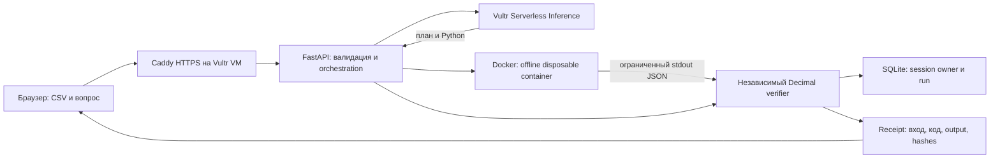

# Архитектура Prooflane

Состояние описания: 2026-11-04. Case workbench добавлен поверх прежнего runner; целевая облачная конфигурация пока NOT_RUN.

## Case workbench

`reconciliation.py` разбирает две независимые CSV-таблицы и сопоставляет точные vendor/item/date. Решения о перекрытиях и исключениях сохраняются рядом с сырыми источниками. Нормализованный шестиколоночный CSV поступает в прежний `execute_run`, поэтому mode gates, verifier, sandbox limits и failures общие для старого и нового интерфейса.

`case_api.py` предоставляет owner-scoped case lifecycle. `case_store.py` создаёт отдельную таблицу SQLite, без изменения прежних runs. Baseline и до4вариантов ссылаются на неизменные run IDs; максимум12distinct changes совместно применяются к оригиналу. Shared contract target распространяет цену на каждую binding row. Case updates используют revision CAS и процессный lock; приложение рассчитано на один worker. Строки cases имеют отдельный24hсрок и лимит200, run references не продлевают сроки.

`intelligence.py` считает диапазоны на host доверенной Decimal-арифметикой, без модели/контейнера. До24target ranges; общая цена — одна переменная. Возвращаются точные монотонные границы, OAT sensitivity, снижение ширины при уточнении входа и зависимый от общей цены strict-leader certificate. Эти значения не являются executed alternative. [Формулы и независимые oracles](INTELLIGENCE_METHODS.md).

`case_evidence.py` реконструирует источники, baseline context, каждый declared joint change, все receipts и аналитику. Экспорт <=8MiB; browser checker отправляет файл серверу, CLI работает offline. Оба переиспользуют доверенные функции проверки; это независимость от модельного output/исходного сервера, не две независимые реализации математики. Отдельный integer-cent oracle в тестах действительно написан независимо.

Create/match JSON ограничен2MiB, каждый CSV128KiB/500rows, matching graph5,000eligible links. Case операции, включая вычислительные GET и packet download, имеют120/session и240/IP запросов в час. Прежние execution/live quotas действуют дополнительно. Форматы: [WORKBENCH_CONTRACT](WORKBENCH_CONTRACT.md). Старый путь ниже сохранён и доступен из Single CSV review.

## Границы и поток

1. Браузер загружает CSV как JSON в same-origin API. Сервер проверяет body limit, схему, типы/диапазоны, количество записей и размер. Идентификатор сессии генерируется случайно и хранится в HttpOnly/SameSite cookie; в БД используется его SHA-256.
2. Доверенная функция `summarize` формирует ожидаемую арифметику. Она не вызывает код модели. В reference-режиме это весь вычислительный путь и отдельная независимость не заявляется.
3. В sandbox-режиме используется фиксированный `RECIPE`. В vultr-режиме сервер отправляет VSI фиксированный контракт, вопрос и число записей. API-ключ остаётся в control plane. Вызов ограничен тайм-аутом и размером ответа; redirects выключены.
4. Executor создаёт контейнер только с фиксированными параметрами. Вход передаётся через stdin; host bind-mounts отсутствуют. Docker inspect проверяет применённые настройки до старта. Генерируемый код исполняется только в контейнере.
5. Executor ограничивает stdout/stderr, ожидает завершение и удаляет контейнер; отсутствие контейнера проверяется. Неподтверждённый cleanup отклоняет результат и создаёт `sandbox-quarantine.json` в data directory. При readiness-проверке нового процесса также ищутся оставшиеся контейнеры с label `prooflane.sandbox=true`; их обнаружение включает карантин. Marker переживает restart, новые sandbox-задачи блокируются до действий оператора.
6. JSON сравнивается с фиксированным контрактом целиком: число записей, billed total, positive variance и упорядоченный список всех findings. Неизвестные поля, неверные типы/значения или неполный набор отклоняются. При неуспехе в vultr-режиме возможна ещё одна генерация с общим feedback. Это не полный repair-agent для произвольных программ.
7. UI получает только проверенный `summary`, доверенное текстовое объяснение и provenance. Объяснение явно обозначено как детерминированное. JSON receipt содержит фактический output, вход, финальный код, проверки, события и данные runtime. `run.attempts` и `receipt.attempts` сохраняют каждую попытку исполнения: код, execution с output, результаты проверки и model metadata; прерванная ошибка sandbox сохраняет доступные execution/error данные. Верхнеуровневые поля code/execution отражают последнюю попытку. У reference-режима список sandbox attempts пустой.

## Компоненты

| Файл | Ответственность |
|---|---|
| `app.py` | HTTP, session boundary, quotas, orchestration и ошибки |
| `analysis.py` | CSV validation, Decimal oracle, output verifier, canonical JSON |
| `provider.py` | Только фиксированный HTTPS endpoint VSI, JSON/code contract |
| `sandbox.py` | Docker lifecycle, fixed controls, bounded I/O, probes |
| `sandbox/runner.py` | Container-only entrypoint, запись CSV в `/tmp`, исполнение кода |
| `receipts.py` | SHA-256 links и offline арифметическая проверка без исполнения кода |
| `comparison.py` | Одно числовое допущение, проверка lineage и полного различия CSV, независимый пересчёт сравнения |
| `store.py` | SQLite, owner-scoped runs, 24h logical expiry, лимит записей |
| `web/` | Same-origin интерфейс без отдельного JS framework/build pipeline |

## Контракты

API: `GET /api/health`, `GET /api/sample`, `GET /api/runs`, `GET /api/runs/{id}`, `GET /api/runs/{id}/receipt`, `POST /api/runs`, `POST /api/containment`. POST требует JSON и `X-Prooflane-Request: 1`; чужой Origin отвергается. Это CSRF-защита браузерного пути, не универсальная аутентификация HTTP-клиентов. Live дополнительно требует operator token.

Сценарии: `GET /api/runs/{id}/source`, `POST /api/runs/{id}/scenario`, `GET /api/runs/{id}/comparison`. Поля и ошибки — в [SCENARIO_CONTRACT](SCENARIO_CONTRACT.md). Только verified original текущей сессии может быть baseline; hash связывает запрос с сохранённой версией. Сценарий проходит общий `execute_run` в исходном режиме и сохраняется отдельным run. Исходный объект не обновляется. Повторный сценарий строится от оригинала, цепочки scenario-on-scenario запрещены. Неуспех сохраняется как failed без summary/receipt/comparison.

Пакет `prooflane.comparison.v1` содержит полные baseline/scenario receipts, lineage и сравнение. Verifier проверяет оба receipt, parent ID/hash, режим и единственное изменение quantity/unit_price/contract_price. Сравниваются все разобранные CSV-записи, включая notes; допустима нормализация сериализации CSV (BOM, quotes, внешние пробелы), а не побайтовое совпадение. Затем независимо пересчитываются все дельты. Скачанный пакет не зависит от срока хранения SQLite; новый экспорт требует наличия обеих версий.

Provider отвергает неправильную оболочку JSON и невалидный UTF-8 в плане, коде и model ID до исполнения. Одна repair-попытка разрешена при несовпавшем output либо ошибке исполнения с **подтверждённым cleanup**; неизвестная/неуспешная очистка не разрешает повтор. Feedback общий, не содержит исходные записи или stderr.

CSV: точный порядок `invoice_id,vendor,quantity,unit_price,contract_price,notes`. USD, 1–500 записей, максимум 128 KiB, cell до 300 символов. Формула `quantity × max(unit_price − contract_price, 0)`; строки с нулевой/отрицательной разницей не попадают в findings. Сумма не является net difference, задолженностью или гарантированным возвратом.

Sandbox: 128 MiB memory и total memory+swap, 0.5 CPU, 32 PID, 16 MiB tmpfs, readonly root, UID/GID 65534, dropped capabilities, no-new-privileges, network none, никаких host mounts или переданных ключей. Обычный timeout 10 секунд; stdout 128 KiB, stderr 32 KiB. Проба использует тот же профиль и отдельный запуск. Параллельно разрешены два run; quotas in-memory и рассчитаны на один worker.

## Хранение и эксплуатация

SQLite хранит run и receipt в `PROOFLANE_DATA_DIR`; максимум 1000 записей. Доступ старше 24h закрывается; удаление устаревших строк выполняется на `add`, `get` и `list`. Фонового таймера нет: после idle-периода старые записи могут оставаться до обращения, а байты — в свободных страницах SQLite и backups. Конфиденциальное гарантированное удаление не реализовано.

Сессия — временная принадлежность результатов, не аккаунт и не recovery mechanism. Очистка cookies лишает доступа к старым run. Перезапуск процесса сбрасывает quotas. Несколько workers/реплик потребуют общего limiter и согласованной очереди; текущая конфигурация явно использует один worker.

## Проверяемые и непроверяемые утверждения

Локальный runtime проверен сохранённым Docker smoke; актуальные тесты перечислены в [TESTING](../TESTING.md). Включены проверки cleanup-failure карантина, сохранения marker после restart, orphan-container gate и retry-контракта с doubles. Эксперимент с реальным SIGKILL процесса и настоящий VSI NOT_RUN. Настройки образа и исполнения доступны в receipt, но их authenticity зависит от сервера. SHA-256 обнаруживает изменение относительно сохранённых значений; атакующий может пересчитать весь unsigned receipt. Offline checker перепроверяет арифметику и связь одного изменения, не аутентифицирует issuer и не подтверждает историю исполнения.

Vultr deployment, настоящий VSI, HTTPS и внешний judge flow требуют отдельной проверки. Linux validation container проверен локально. gVisor, microVM, distributed queue, SSO, подписи receipt, отдельный защищённый Docker broker и автоматические платежи не реализованы.
