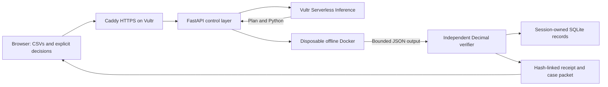

# Prooflane architecture

Updated 9 November 2026. The public application is deployed on a dedicated Vultr VM; real Serverless Inference, Docker, browser and offline checks have run. [Current evidence](../TESTING.md).

## Case lifecycle

`reconciliation.py` reads independent invoice and contract CSVs and matches exact vendor/item keys with inclusive dates. The reviewer resolves overlaps and supplies reasons for exclusions. The frozen raw sources and decisions produce the six-column normalized CSV used by the existing `execute_run` pipeline. Thus case and single-CSV flows share provider gates, sandbox controls and the arithmetic verifier.

`case_api.py` exposes owner-scoped operations; `case_store.py` stores a separate case table alongside runs. A baseline and up to four alternatives refer to immutable run IDs. Up to twelve distinct changes are applied jointly to the original baseline, with shared contract prices propagated to every bound invoice. Revision compare-and-swap and a process lock prevent lost updates. The service uses one worker. Cases have a 200-record cap and separate 24-hour expiry; a case reference does not extend a run's lifetime.

`intelligence.py` uses trusted host-side Decimal arithmetic for up to 24 declared target ranges. A shared contract is one variable. It returns exact monotone bounds, one-at-a-time sensitivity, deterministic range reduction and a strict-leader certificate. `priority_switch.py` computes whole-cent boundaries with adjacent witnesses. These calculations are not model predictions or separately executed alternatives. [Methods](INTELLIGENCE_METHODS.md).

`case_evidence.py` reconstructs sources, context, changes, receipts and analytics. The browser uploads a packet to the server; the CLI works offline. Both reuse trusted verification functions. Independence is from model output and the original server, not two separately written production verifiers. Tests include a genuinely separate integer-cent oracle.

## Execution sequence

1. The same-origin API validates JSON/body size, CSV schema, types, ranges and record counts. A random session cookie establishes temporary ownership; SQLite stores its SHA-256.
2. Trusted `summarize` computes expected arithmetic. Reference mode uses this fixed path and explicitly makes no independent-execution claim.
3. Sandbox mode uses a fixed recipe. Vultr mode sends the bounded contract, question and row count to VSI; it does not automatically send raw rows. Credentials stay on the server. Response size, timeout, Unicode and response-envelope checks precede execution.
4. The executor creates a fixed-profile container, inspects actual controls before starting, and supplies input through stdin. Generated Python never executes on the host.
5. Bounded stdout/stderr are collected; the container is removed and its absence checked. Unconfirmed cleanup persists quarantine and blocks further sandbox work. Orphan detection also runs on process readiness.
6. The independent verifier checks exact output fields, record count, billed total, positive variance and the complete ordered finding list. Wrong types, missing rows or unknown fields reject the result. At most one model repair is allowed after confirmed cleanup, with generic feedback only.
7. After verification, a separate VSI request selects the focus and next review step from a bounded contract. The server inserts checked amounts. Invalid guidance receives a disclosed deterministic fallback; it cannot invent totals. Receipts retain code, output, events, usage, actual model/request IDs, execution controls and each attempt. Reference receipts have no container attempts.

The observed model is `deepseek-v4.1-flash-1017`; availability is provider/account-specific. Its bounded-JSON calls explicitly disable default reasoning. A failed incomplete response was preserved before the successful retest. [Live history](LIVE_AI_CHECK_20261109.md).

## Contracts and limits

The single-CSV schema is `invoice_id,vendor,quantity,unit_price,contract_price,notes`. USD prices have at most two decimal places, quantities are positive integers, cells are bounded, and each file has at most 500 rows / 128 KiB. The formula is `quantity × max(unit_price − contract_price, 0)`. Negative differences are not netted against positive ones. This is neither debt nor recovered cash.

Runtime: network none, read-only root, UID/GID 65534, no host mounts or injected credentials, 128 MiB memory and swap cap, 0.5 CPU, 32 PIDs, 16 MiB tmpfs, all capabilities dropped, no-new-privileges, 10-second normal deadline, 128 KiB stdout and 32 KiB stderr. Fixed containment probes use a fresh container with the same profile. Two executions may run concurrently.

Case create/match JSON is capped at 2 MiB and 5,000 eligible links. Packet verification/export is capped at 8 MiB. Case operations have per-session/IP in-memory quotas in addition to execution/live quotas. A custom request header and Origin checks protect the browser POST path; a separate operator token gates inference spending. [Workbench contract](WORKBENCH_CONTRACT.md), [legacy scenario contract](SCENARIO_CONTRACT.md).

Core endpoints include health, samples, owner-scoped runs/receipts, case creation/reconciliation/alternatives/exploration, containment and packet verification. A scenario must use its original verified baseline, original mode and receipt hash; scenario-on-scenario chaining is rejected. Complete parsed source differences, parent links and deltas are checked, including notes. Serialization normalization does not permit undeclared semantic edits.

## Storage and deployment boundaries

Runs have a 1,000-record cap; access expires after 24 hours. Cleanup occurs on add/get/list. There is no secure wipe or background deletion guarantee. Browser storage retains only case/navigation and pending operation IDs, not raw CSV or credentials. Clearing cookies loses ownership access. Request IDs support recovery without silently repeating a charged POST.

The Vultr VM hosts FastAPI, SQLite and the Docker dispatcher; Caddy provides public HTTPS while Uvicorn binds to loopback. One worker is required for the current in-memory limits and locks. Multiple replicas need a shared limiter, queue and persistence design.

Docker is a shared-kernel boundary with privileged daemon access, not a microVM. gVisor, signatures, SSO, a separate protected broker and distributed queues are not implemented. Real SIGKILL, broad public load testing, customer studies, physical touch and full screen-reader listening remain outside recorded verification. [Security](../SECURITY.md), [deployment](DEPLOYMENT.md).
